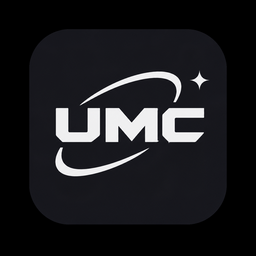
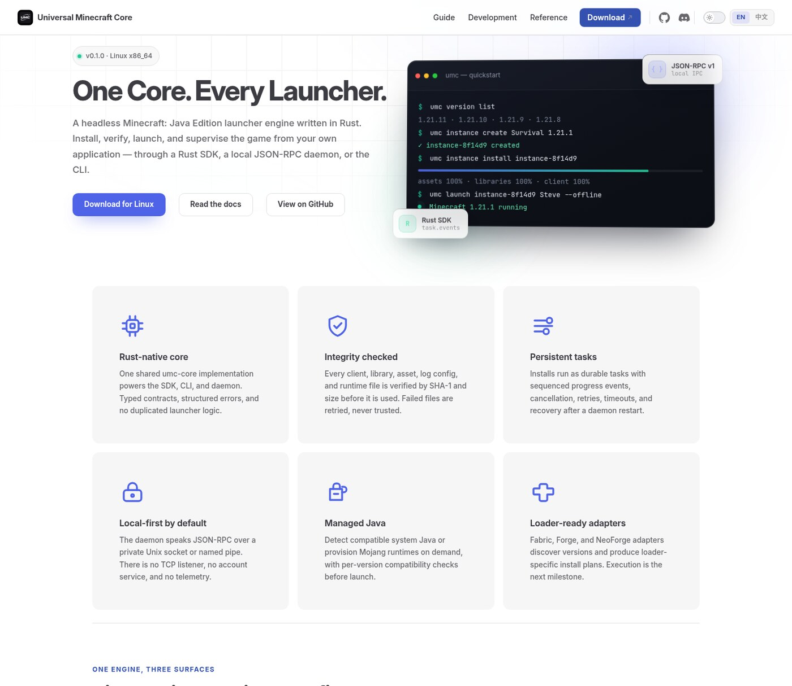

<div align="center">



<h1>Universal Minecraft Core</h1>

<p><strong>One Core. Every Launcher.</strong></p>

<p>
  A headless Minecraft: Java Edition launcher engine written in Rust.<br />
  Install, verify, launch, and supervise the game from your own application.
</p>

<p>
  <a href="https://github.com/UMC-Community/UMC/actions/workflows/ci.yml"></a>
  <a href="https://github.com/UMC-Community/Docs/actions/workflows/pages.yml"></a>
  <a href="https://github.com/UMC-Community/UMC/releases/latest"></a>
  <a href="LICENSE"></a>
  
  
</p>

<p>
  <a href="https://umc-community.github.io/Docs/en/">Documentation</a> ·
  <a href="https://umc-community.github.io/Docs/en/guide/quickstart">Quickstart</a> ·
  <a href="https://umc-community.github.io/Docs/zh/">简体中文</a> ·
  <a href="https://github.com/UMC-Community/UMC/releases/latest">Releases</a> ·
  <a href="https://discord.gg/d5qKvMp9Wc">Discord</a>
</p>

</div>



## Why UMC?

UMC separates launcher functionality from the user interface. Your application owns the window,
accounts, and product experience; UMC owns version discovery, verified downloads, instances, tasks,
Java, launch, and process supervision.

One engine is available through four surfaces:

- **Rust SDK** — typed calls, in-process or through the local daemon.
- **Local daemon** — newline-delimited JSON-RPC over a private Unix socket or Windows named pipe.
- **CLI** — scripts, automation, and manual operations.
- **stdio JSON-RPC** — a child-process adapter for sandboxed integrations.

## Features

| | Capability | Details |
|---|---|---|
| 🦀 | **Rust-native core** | One `umc-core` implementation powers the SDK, CLI, stdio adapter, and daemon. |
| 🔒 | **Integrity checked** | Downloaded client JARs, libraries, assets, logging configuration, and managed runtimes are checked against upstream SHA-1 and size metadata where provided. |
| ⚙️ | **Persistent tasks** | Install operations expose sequenced progress events, cancellation, retries, timeouts, and restart recovery. |
| 🖥️ | **Local-first daemon** | Local-only IPC with owner-only permissions. The launcher Core has no TCP listener, hosted account service, or telemetry. |
| ☕ | **Managed Java** | Detect compatible system Java or provision a verified Mojang runtime for a specific version. |
| 📦 | **Isolated instances** | Each instance has its own config, game directory, logs, and verified install record. |
| 🧩 | **Loader-ready adapters** | Fabric, Forge, and NeoForge version discovery and install preflight plans. |
| 🛠️ | **Repair and recovery** | Atomic config writes, backups, corruption quarantine, instance repair, and process state recovery. |

## Architecture

```text
GUI / scripts ── Rust SDK ──┐
GUI / scripts ── JSON-RPC ──┼── umc-core ── OS, filesystem, HTTPS
Terminal ─────── CLI ───────┘
```

`umc-core` is the only owner of launcher behavior. Every surface delegates to it, so task state,
instance data, errors, and process handling stay consistent.

## Project status

| Area | Status |
|---|---|
| Vanilla version discovery and verified downloads | ✅ Available |
| Isolated instance installation and repair | ✅ Available |
| Explicit offline launch and process supervision | ✅ Available |
| Java detection and managed Mojang runtimes | ✅ Available |
| Persistent tasks, local daemon, CLI, Rust SDK, JSON-RPC | ✅ Available |
| Fabric / Forge / NeoForge version discovery and preflight | ✅ Available |
| Microsoft account sign-in and vanilla online launch | ✅ Available |
| Loader installation and loader online launch | ⏸️ Paused after version discovery and install preflight |
| Mods, modpacks, and resource packs | 🚧 Planned |
| Windows and macOS ports | 🚧 Planned |

## Quickstart

Build from source:

```sh
git clone https://github.com/UMC-Community/UMC.git
cd UMC
cargo build --workspace --locked --release

./target/release/umc version list
./target/release/umc instance create Survival 1.21.1
./target/release/umc instance install <instance-id>
./target/release/umc java install 1.21.1
./target/release/umc auth login
./target/release/umc launch <instance-id> --online
```

Offline launch is still available for local testing:

```sh
./target/release/umc launch <instance-id> --offline Steve
```

Or download the latest Linux archive from
[GitHub Releases](https://github.com/UMC-Community/UMC/releases/latest) and verify its SHA-256 checksum.

Read the full [Quickstart](https://umc-community.github.io/Docs/en/guide/quickstart) for release setup,
Java provisioning, logs, and first-run details.

> [!WARNING]
> Offline launch does not verify account ownership and cannot join authenticated servers. Use `umc auth login` plus `umc launch --online` for online play. UMC stores only the Microsoft refresh token in the OS keyring (or a `0600` file fallback) and never stores your password.

## Optional companion services

UMC also ships independently deployable services under [`services/`](services/):

| Service | Status | Purpose |
|---|---|---|
| [Auth server](services/auth/) | Account system implemented | Self-hosted Go/Nginx/PostgreSQL accounts with `/api/v1`, a Vue panel, optional Stalwart mail, and Yggdrasil-compatible authentication |
| Java Edition server | Planned | Dockerized Minecraft: Java Edition server |
| Mirror | Initial implementation | HTTPS-only Go cache with SHA-1 verification for configured upstream objects |

The Auth and Mirror services currently have Docker Compose deployments. Auth runs behind Nginx with
a private Go API and PostgreSQL; an optional Stalwart mail profile and a Vue user center/admin panel
are included. The Java
Edition server is planned and is not packaged yet. All companion services are optional; `umc` and
`umcd` do not require them. UMC Auth is a community-operated Yggdrasil-compatible account service,
separate from the launcher's Microsoft sign-in and ownership checks.

## Documentation

| User documentation | Developer documentation | Reference |
|---|---|---|
| [User guide](https://umc-community.github.io/Docs/en/guide/user-guide)<br />[Quickstart](https://umc-community.github.io/Docs/en/guide/quickstart)<br />[CLI reference](https://umc-community.github.io/Docs/en/guide/cli)<br />[Instances](https://umc-community.github.io/Docs/en/guide/instances)<br />[Java runtimes](https://umc-community.github.io/Docs/en/guide/java)<br />[Launching](https://umc-community.github.io/Docs/en/guide/launching)<br />[Troubleshooting](https://umc-community.github.io/Docs/en/guide/troubleshooting) | [Integration guide](https://umc-community.github.io/Docs/en/development/)<br />[Rust SDK](https://umc-community.github.io/Docs/en/development/sdk)<br />[Architecture](https://umc-community.github.io/Docs/en/development/architecture)<br />[Loader adapters](https://umc-community.github.io/Docs/en/development/loaders)<br />[JSON-RPC client guide](https://umc-community.github.io/Docs/en/development/rpc-client)<br />[Testing and CI](https://umc-community.github.io/Docs/en/development/testing)<br />[Contributing](https://umc-community.github.io/Docs/en/development/contributing) | [JSON-RPC v1](https://umc-community.github.io/Docs/en/reference/rpc-v1)<br />[Auth API v1](https://umc-community.github.io/Docs/en/reference/auth-v1)<br />[Compatibility policy](https://umc-community.github.io/Docs/en/about/compatibility)<br />[Privacy Policy](https://umc-community.github.io/Docs/en/about/privacy)<br />[Terms of Service](https://umc-community.github.io/Docs/en/about/terms)<br />[v0.1.0 release notes](https://umc-community.github.io/Docs/en/reference/releases/v0.1.0) |

The documentation is available in [English](https://umc-community.github.io/Docs/en/) and
[简体中文](https://umc-community.github.io/Docs/zh/).

## Requirements

- Linux x86_64 GNU is the current release target.
- Rust 1.89 or newer when building from source.
- Network access for version metadata, game files, and Java runtimes.

Windows and macOS are planned ports and are not part of the validated release target yet.

## Repository layout

<details>
<summary>Show the repository structure</summary>

```text
crates/
  umc-api            public contracts
  umc-core           launcher engine
  umc-sdk            typed Rust facade
  umc-cli            umc CLI and umcd daemon
  umc-loader-api     loader adapter contract
  umc-loader-fabric  Fabric Meta adapter
  umc-loader-forge   Forge Maven adapter
  umc-loader-neoforge NeoForge Maven adapter
  umc-loader-registry built-in and host adapters
protocols/           canonical contracts: JSON-RPC and Auth API v1
```

</details>

## Community

Join the [UMC Discord server](https://discord.gg/d5qKvMp9Wc) to follow development, ask questions,
and share integrations.

- [Report an issue](https://github.com/UMC-Community/UMC/issues)
- [Contributing guide](https://umc-community.github.io/Docs/en/development/contributing)

## License

UMC is licensed under the [MIT License](LICENSE).

UMC is an independent project. It is not an official Minecraft product and is not approved by or
associated with Mojang or Microsoft. Minecraft game files, Mojang/Microsoft marks, mod loaders, and
mods remain the property of their respective owners.
